INSTRUCCIONES DE IMPLEMENTACIÓN — PÁGINA DEL ÁRBOL DE PROBLEMAS (no mostrar al visitante)
1. Usar este Markdown como contenido exclusivo de la ruta /arbol-problemas/.
2. En un repositorio con GitHub Pages + Jekyll, guardar este documento con un nombre .md en la raíz
   y configurar el sitio para compilar Markdown; requiere layout "page" disponible.
3. Conservar los IDs P0, C1–C8, I1–I8, E1–E8 y T1–T3 para enlazar nodos con sus fichas.
4. Requisito visual del producto final: representar un ÁRBOL reconocible, no solamente tarjetas:
   raíces inferiores = causas estructurales/indirectas/directas; tronco = problema central;
   copa superior = efectos. Hacerlo con SVG/HTML/CSS y conexiones legibles.
5. Cada zona (raíces, tronco, ramas y hojas) debe admitir clic o teclado y abrir una ventana modal
   con título, causa, explicación, ejemplo, efecto y vínculo con el árbol de soluciones.
6. El Mermaid incluido es una visualización funcional provisional y también una guía de jerarquía.
   La mejora estética a árbol ilustrado puede hacerse después sin cambiar las fichas ni IDs.
7. La vista pública debe contener únicamente el diagnóstico, sus relaciones y las fichas explicativas.
8. No presentar hipótesis y ejemplos del equipo como estadísticas ya demostradas.

# Árbol de problemas: cuando cumplir reemplaza aprender

**Actividad:** Crisis y soluciones para la educación  
**Contexto:** educación superior, con ejemplos de Ingeniería de Sistemas y enseñanza mediada por inteligencia artificial.  
**Enfoque:** Diagnóstico causal participativo de las condiciones que debilitan el aprendizaje.

> **Tesis para debatir:** La inteligencia artificial puede ampliar las posibilidades de enseñar y aprender, pero si docentes y estudiantes la utilizan para reemplazar el diseño, la práctica, la reflexión y la verificación, la actividad académica corre el riesgo de convertirse en un trámite. El problema no es la IA en sí misma, sino la pérdida de oportunidades de aprendizaje significativo.

## Tronco: un solo problema central

**P0 — Insuficiente consolidación del aprendizaje autónomo, crítico y aplicado en la educación superior.**

**Pregunta problematizadora:** ¿Por qué, aun cuando docentes y estudiantes disponen de más herramientas y producen más entregables, no siempre se consolidan la comprensión profunda, el pensamiento crítico y la capacidad de resolver problemas sin apoyo inmediato?

**Campo principal:** pedagogía y evaluación; se relaciona con didáctica, currículo y gobernanza.

**Cómo leer el árbol:** de abajo hacia arriba: causas estructurales e indirectas → causas directas → problema central → efectos. Los vínculos expresan hipótesis razonadas para discutir y contrastar con evidencias; **no son resultados de una medición empírica**.

<strong>P0. Problema central — aprendizaje autónomo, crítico y aplicado insuficiente</strong>

La mayor disponibilidad de herramientas digitales no garantiza, por sí misma, comprensión profunda ni resolución independiente de problemas. El diagnóstico analiza causas en pedagogía, evaluación, didáctica y gobernanza; no atribuye toda la crisis a la IA. **Pregunta central:** ¿Cómo recuperar oportunidades reales de construir y demostrar el aprendizaje?

## Diagrama del árbol

Este diagrama Mermaid representa la estructura arbórea. Las ramas C1–C8 son las ocho causas directas; los nodos E1–E8 son sus efectos y las raíces I1–I8 representan causas indirectas. En GitHub, Mermaid puede representarse en la vista Markdown; para asegurar el renderizado en GitHub Pages será necesario incluir su biblioteca en el sitio.

```mermaid
flowchart BT
    P0["TRONCO · P0<br/>Aprendizaje autónomo, crítico y aplicado insuficiente"]
    I1["INDIRECTA I1<br/>Las tareas se valoran principalmente por la resp…"] --> C1["C1 · La IA reemplaza el intento propio"]
    C1 --> P0
    P0 --> E1["E1 · Menor autonomía para resolver y defender problemas"]
    I2["INDIRECTA I2<br/>Tiempo limitado para revisar propuestas automati…"] --> C2["C2 · Material asistido por IA sin curaduría"]
    C2 --> P0
    P0 --> E2["E2 · Abundancia de productos educativos con comprensión superficial"]
    I3["INDIRECTA I3<br/>Instrumentos…"] --> C3["C3 · Se califica el entregable, no el proceso"]
    C3 --> P0
    P0 --> E3["E3 · Las calificaciones reflejan de forma incompleta las competencias"]
    I4["INDIRECTA I4<br/>Falta de hitos intermedios, autoevaluación…"] --> C4["C4 · Poca retroalimentación durante el avance"]
    C4 --> P0
    P0 --> E4["E4 · Errores que se repiten y debilidad metacognitiva"]
    I5["INDIRECTA I5<br/>Escasa articulación entre asignaturas, experienc…"] --> C5["C5 · Ejercicios poco conectados con contextos reales"]
    C5 --> P0
    P0 --> E5["E5 · Dificultad para transferir saberes y pérdida de sentido"]
    I6["INDIRECTA I6<br/>Se prioriza completar el temario o el proyecto g…"] --> C6["C6 · Poca experimentación individual"]
    C6 --> P0
    P0 --> E6["E6 · Brechas de competencias ocultas por productos colectivos"]
    I7["INDIRECTA I7<br/>Diferencias en conectividad, equipos, tiempo dis…"] --> C7["C7 · Acceso y competencias tecnológicas desiguales"]
    C7 --> P0
    P0 --> E7["E7 · Participación desigual y oportunidades de aprendizaje asimétricas"]
    I8["INDIRECTA I8<br/>Criterios heterogéneos entre asignaturas acerca …"] --> C8["C8 · Faltan acuerdos claros sobre IA y autoría"]
    C8 --> P0
    P0 --> E8["E8 · Incertidumbre, tensiones de confianza y riesgos de autoría"]
    T1["T1 · Cultura del cumplimiento"] --> I1
    T1 --> I3
    T1 --> I4
    T1 --> I6
    T2["T2 · Adopción tecnológica acelerada"] --> I2
    T2 --> I8
    T3["T3 · Brechas y pertinencia"] --> I5
    T3 --> I7
    classDef trunk fill:#7559a7,color:#fff,stroke:#4b3674,stroke-width:3px;
    classDef direct fill:#dceafe,color:#15314c,stroke:#5d92d7,stroke-width:1.4px;
    classDef indirect fill:#d7eee6,color:#1b4b3c,stroke:#73aa95;
    classDef effect fill:#ffe3ae,color:#4e3517,stroke:#e3a43a,stroke-width:1.4px;
    classDef deep fill:#fae0df,color:#632b2b,stroke:#c68f8a;
    class P0 trunk;
    click P0 "#p0" "Abrir problema central"
    class C1,C2,C3,C4,C5,C6,C7,C8 direct;
    class I1,I2,I3,I4,I5,I6,I7,I8 indirect;
    class E1,E2,E3,E4,E5,E6,E7,E8 effect;
    class T1,T2,T3 deep;
    click I1 "#c1" "Abrir la ficha de C1"
    click C1 "#c1" "Abrir la ficha de C1"
    click E1 "#c1" "Abrir la ficha de C1"
    click I2 "#c2" "Abrir la ficha de C2"
    click C2 "#c2" "Abrir la ficha de C2"
    click E2 "#c2" "Abrir la ficha de C2"
    click I3 "#c3" "Abrir la ficha de C3"
    click C3 "#c3" "Abrir la ficha de C3"
    click E3 "#c3" "Abrir la ficha de C3"
    click I4 "#c4" "Abrir la ficha de C4"
    click C4 "#c4" "Abrir la ficha de C4"
    click E4 "#c4" "Abrir la ficha de C4"
    click I5 "#c5" "Abrir la ficha de C5"
    click C5 "#c5" "Abrir la ficha de C5"
    click E5 "#c5" "Abrir la ficha de C5"
    click I6 "#c6" "Abrir la ficha de C6"
    click C6 "#c6" "Abrir la ficha de C6"
    click E6 "#c6" "Abrir la ficha de C6"
    click I7 "#c7" "Abrir la ficha de C7"
    click C7 "#c7" "Abrir la ficha de C7"
    click E7 "#c7" "Abrir la ficha de C7"
    click I8 "#c8" "Abrir la ficha de C8"
    click C8 "#c8" "Abrir la ficha de C8"
    click E8 "#c8" "Abrir la ficha de C8"
    click T1 "#t1" "Abrir raíz estructural T1"
    click T2 "#t2" "Abrir raíz estructural T2"
    click T3 "#t3" "Abrir raíz estructural T3"
```

## Fichas interactivas: causas y efectos

Selecciona cualquier nodo del diagrama para abrir su ficha en una ventana emergente; las fichas también pueden desplegarse más abajo. C1–C8, I1–I8 y E1–E8 permiten seguir la relación causa–problema–efecto.

### Eje 1 — Inteligencia artificial y esfuerzo intelectual

<strong>C1. La IA sustituye etapas esenciales del razonamiento</strong> · abrir rama y efecto E1

**Tipo:** causa directa; **efecto vinculado:** E1; **solución asociada:** S1.

**Raíz indirecta I1:** Las tareas se valoran principalmente por la respuesta entregada y no siempre exigen mostrar intentos, errores, contrastes y decisiones.

**Dimensión estructural:** Cultura de inmediatez y productividad en la que terminar una tarea puede pesar más que comprenderla.

**¿Por qué alimenta el problema central?** Cuando se obtiene directamente una solución de un asistente, se pueden omitir la formulación del problema, el ensayo, la depuración y la argumentación. El riesgo no es utilizar IA, sino delegar en ella el trabajo cognitivo que la actividad pretendía desarrollar.

**Ejemplo situado (para discutir, no dato estadístico):** En programación, un estudiante puede entregar un algoritmo funcional generado con IA y, aun así, no explicar sus condiciones, probar casos límite ni corregir un error sin ayuda.

**Hoja o efecto E1 — Menor autonomía para resolver y defender problemas:** El estudiante completa la actividad, pero presenta dificultades para reconstruir el procedimiento, justificar decisiones o transferir lo aprendido a una situación nueva.

**Qué evidencia se podría recopilar:** Resolver y explicar una variante breve de la tarea sin asistencia, comparando con el desempeño observado durante la entrega.

**Transición a la solución:** Esta rama se corresponde con **S1** en el árbol de soluciones.

<strong>C2. Uso docente de IA sin suficiente mediación ni validación</strong> · abrir rama y efecto E2

**Tipo:** causa directa; **efecto vinculado:** E2; **solución asociada:** S2.

**Raíz indirecta I2:** Tiempo limitado para revisar propuestas automatizadas y ausencia de rutinas consistentes para verificar su exactitud y pertinencia pedagógica.

**Dimensión estructural:** Velocidad de adopción tecnológica mayor que la disponibilidad de formación pedagógica y espacios de reflexión compartida.

**¿Por qué alimenta el problema central?** El uso docente de IA puede acelerar guías, cuestionarios y explicaciones, pero el material generado no garantiza secuencia didáctica, rigurosidad técnica ni adecuación a los conocimientos previos.

**Ejemplo situado (para discutir, no dato estadístico):** Una actividad de ciencia de datos puede tener un código aparentemente correcto que oculta fuga de datos, supuestos inválidos o una dificultad superior a la prevista para el grupo.

**Hoja o efecto E2 — Abundancia de productos educativos con comprensión superficial:** Se cubren actividades y contenidos con rapidez, aunque persisten vacíos conceptuales o errores no detectados por el alumnado.

**Qué evidencia se podría recopilar:** Auditar ejemplos, pedir explicaciones de decisiones y contrastar diagnósticos breves antes y después de cada secuencia.

**Transición a la solución:** Esta rama se corresponde con **S2** en el árbol de soluciones.

### Eje 2 — Evaluación y retroalimentación

<strong>C3. Evaluación centrada en el producto final</strong> · abrir rama y efecto E3

**Tipo:** causa directa; **efecto vinculado:** E3; **solución asociada:** S3.

**Raíz indirecta I3:** Instrumentos y rúbricas que priorizan la presentación final y recogen poca evidencia de exploración, revisión y trabajo individual.

**Dimensión estructural:** Tradición de medición del rendimiento por calificaciones y entregables, reforzada por restricciones de tiempo y carga de cursos.

**¿Por qué alimenta el problema central?** Cuando el archivo final concentra la nota, es difícil distinguir comprensión auténtica, asistencia legítima y reproducción no comprendida de salidas generadas.

**Ejemplo situado (para discutir, no dato estadístico):** Un repositorio, informe o dashboard puede tener muy buena presentación sin hacer visible quién tomó las decisiones de limpieza, modelado, pruebas y validación.

**Hoja o efecto E3 — Las calificaciones reflejan de forma incompleta las competencias:** Una nota elevada puede coexistir con inseguridad para explicar y ejecutar tareas básicas de manera autónoma.

**Qué evidencia se podría recopilar:** Comparar la rúbrica del entregable con una defensa oral o práctica individual corta y con el historial de versiones.

**Transición a la solución:** Esta rama se corresponde con **S3** en el árbol de soluciones.

<strong>C4. Retroalimentación y autorregulación insuficientes</strong> · abrir rama y efecto E4

**Tipo:** causa directa; **efecto vinculado:** E4; **solución asociada:** S4.

**Raíz indirecta I4:** Falta de hitos intermedios, autoevaluación y oportunidades explícitas de corregir después de recibir observaciones.

**Dimensión estructural:** Organización académica que puede favorecer el cierre administrativo de actividades frente al acompañamiento formativo continuo.

**¿Por qué alimenta el problema central?** Si la retroalimentación llega al final, el estudiante conoce su nota pero tiene escasas oportunidades de comprender errores y ajustar su estrategia de aprendizaje.

**Ejemplo situado (para discutir, no dato estadístico):** En un proyecto de base de datos, los errores de normalización o de consultas SQL persisten si solo se revisan al entregar el producto definitivo.

**Hoja o efecto E4 — Errores que se repiten y debilidad metacognitiva:** Se dificulta reconocer lo que todavía no se domina, pedir ayuda pertinente y mejorar entre una versión y la siguiente.

**Qué evidencia se podría recopilar:** Revisar las diferencias justificadas entre la primera y la segunda entrega y aplicar autoevaluaciones de confianza fundamentada.

**Transición a la solución:** Esta rama se corresponde con **S4** en el árbol de soluciones.

### Eje 3 — Didáctica, proyectos y práctica

<strong>C5. Actividades desvinculadas de problemas reales</strong> · abrir rama y efecto E5

**Tipo:** causa directa; **efecto vinculado:** E5; **solución asociada:** S5.

**Raíz indirecta I5:** Escasa articulación entre asignaturas, experiencias de práctica y datos o necesidades de organizaciones reales.

**Dimensión estructural:** Separación persistente entre la planificación curricular y los cambios técnicos, laborales y sociales del entorno.

**¿Por qué alimenta el problema central?** Sin contexto de uso, algunas técnicas se convierten en instrucciones para repetir, no en herramientas para analizar y decidir.

**Ejemplo situado (para discutir, no dato estadístico):** Aprender SQL o visualización con ejemplos aislados puede resultar menos significativo que analizar datos abiertos de contratación pública, detectar errores y explicar hallazgos para una decisión.

**Hoja o efecto E5 — Dificultad para transferir saberes y pérdida de sentido:** Se aprueban temas, pero resulta más difícil usarlos para interpretar situaciones auténticas de prácticas, proyectos y trabajo profesional.

**Qué evidencia se podría recopilar:** Evaluar si los estudiantes justifican las técnicas escogidas al trabajar un caso nuevo con datos reales o realistas.

**Transición a la solución:** Esta rama se corresponde con **S5** en el árbol de soluciones.

<strong>C6. Escasa práctica individual antes de la entrega grupal</strong> · abrir rama y efecto E6

**Tipo:** causa directa; **efecto vinculado:** E6; **solución asociada:** S6.

**Raíz indirecta I6:** Se prioriza completar el temario o el proyecto grupal sin asegurar momentos de ensayo individual, fallos y depuración.

**Dimensión estructural:** Presión por cubrir contenidos amplios y por demostrar resultados en plazos académicos ajustados.

**¿Por qué alimenta el problema central?** Un equipo puede producir un resultado correcto aunque varios integrantes no hayan practicado las operaciones fundamentales ni tomado decisiones propias.

**Ejemplo situado (para discutir, no dato estadístico):** En Python, OpenRefine o aprendizaje automático, alguien puede participar en la exposición de un proyecto sin haber limpiado un conjunto de datos, evaluado un modelo o corregido un error real.

**Hoja o efecto E6 — Brechas de competencias ocultas por productos colectivos:** La participación desigual no siempre es visible y puede dejar estudiantes con escasa seguridad para trabajar de forma independiente.

**Qué evidencia se podría recopilar:** Aplicar microretos individuales antes y después del trabajo grupal y documentar aportes verificables, sin usar una vigilancia excesiva.

**Transición a la solución:** Esta rama se corresponde con **S6** en el árbol de soluciones.

### Eje 4 — Equidad y gobernanza educativa

<strong>C7. Desigualdad en acceso y alfabetización digital</strong> · abrir rama y efecto E7

**Tipo:** causa directa; **efecto vinculado:** E7; **solución asociada:** S7.

**Raíz indirecta I7:** Diferencias en conectividad, equipos, tiempo disponible y experiencia para usar, cuestionar y verificar sistemas de IA.

**Dimensión estructural:** Brechas socioeconómicas y de infraestructura que trascienden la capacidad de intervención de una sola asignatura.

**¿Por qué alimenta el problema central?** La misma exigencia tecnológica puede representar oportunidades dispares: algunos estudiantes disponen de mejores dispositivos y recursos; otros dependen de herramientas limitadas o de conectividad irregular.

**Ejemplo situado (para discutir, no dato estadístico):** Exigir servicios de pago o cómputo intensivo para actividades con IA puede impedir la participación equitativa, incluso cuando existen alternativas gratuitas o de bajo consumo.

**Hoja o efecto E7 — Participación desigual y oportunidades de aprendizaje asimétricas:** Las diferencias de acceso y alfabetización pueden amplificar las distancias entre estudiantes y sesgar la valoración de sus aprendizajes.

**Qué evidencia se podría recopilar:** Aplicar un diagnóstico voluntario de recursos y competencias; revisar barreras de acceso y participación durante el curso.

**Transición a la solución:** Esta rama se corresponde con **S7** en el árbol de soluciones.

<strong>C8. Criterios poco claros para uso ético de IA</strong> · abrir rama y efecto E8

**Tipo:** causa directa; **efecto vinculado:** E8; **solución asociada:** S8.

**Raíz indirecta I8:** Criterios heterogéneos entre asignaturas acerca de qué usos de IA son válidos, cómo declararlos y cómo proteger la información.

**Dimensión estructural:** Marcos de formación, evaluación y gobernanza que necesitan adaptarse al cambio tecnológico de manera participativa.

**¿Por qué alimenta el problema central?** La falta de acuerdos puede llevar a esconder el uso de IA, prohibirlo indiscriminadamente o aceptarlo sin límites, sin precisar qué aprendizaje debe demostrar cada persona.

**Ejemplo situado (para discutir, no dato estadístico):** Si una asignatura autoriza asistentes para depuración y otra sanciona cualquier ayuda sin explicitar distinciones, el estudiante puede recibir mensajes contradictorios.

**Hoja o efecto E8 — Incertidumbre, tensiones de confianza y riesgos de autoría:** Se generan dudas sobre equidad, transparencia, integridad académica y protección de datos compartidos con herramientas externas.

**Qué evidencia se podría recopilar:** Revisar declaraciones de uso, percepciones de claridad y casos discutidos de manera formativa por estudiantes y docentes.

**Transición a la solución:** Esta rama se corresponde con **S8** en el árbol de soluciones.

## Raíces estructurales compartidas

Las raíces profundas **no deben atribuirse exclusivamente a la IA**. Se proponen tres factores transversales para discutir con el grupo:

- **T1. Cultura del cumplimiento:** se tiende a valorar haber entregado, aprobado o completado por encima del proceso de comprensión. Se vincula especialmente con C1, C3, C4 y C6.
- **T2. Transformación tecnológica más rápida que su integración pedagógica:** aparecen herramientas antes de consolidar criterios de diseño, validación y autoría. Se vincula con C2 y C8.
- **T3. Desigualdades y brechas de pertinencia:** diferencias en acceso y articulación con el entorno reducen oportunidades reales de aprendizaje. Se vincula con C5 y C7.

Estas raíces son hipótesis estructurales de discusión; su modificación requiere actores y plazos distintos a los de una clase.

<strong>T1. Cultura del cumplimiento</strong>

Presión por entregar, aprobar o completar, por encima de demostrar comprensión. Es una hipótesis estructural que influye en C1, C3, C4 y C6. Su transformación demanda cambios compartidos en evaluación y expectativas formativas.

<strong>T2. Transformación tecnológica acelerada</strong>

Nuevas herramientas aparecen antes de que se consoliden criterios de formación, revisión docente y autoría. Influye en C2 y C8. Se requiere mediación pedagógica, no asumir que utilizar IA produce aprendizaje automáticamente.

<strong>T3. Desigualdades y pertinencia del aprendizaje</strong>

Las diferencias en acceso y la débil conexión entre tareas y problemas del contexto influyen en C5 y C7. Las posibilidades de mejora combinan acciones del aula y decisiones institucionales.

## Posibles señales para contrastar el diagnóstico

No se afirman porcentajes inexistentes. Para validar el árbol, el equipo podría contrastar: desempeño en defensas individuales, calidad de bitácoras de aprendizaje, correcciones entre versiones, encuestas de motivación y acceso, o coherencia entre nota del entregable y capacidad de explicación. Son **indicadores propuestos**, no datos recolectados.

## Campo de influencia y priorización

**Actuación directa de docentes y estudiantes:** rediseño de actividades y rutinas de uso de IA (C1–C2), evaluación y retroalimentación (C3–C4), retos contextualizados y microprácticas (C5–C6). **Acción compartida con la institución:** acceso equitativo y acuerdos sobre IA (C7–C8). **Fuera del control inmediato del equipo:** desigualdad estructural, cultura general de credencialismo y velocidad de innovación.

Antes de declarar cuáles son las tres causas críticas, el equipo debería discutirlas y, si se aplica la metodología completa de Bautista Roa, ponderar su incidencia con la matriz 0 (nula), 1 (baja), 2 (media) y 3 (alta). Aquí **no se simula ese consenso ni se inventan puntuaciones**.

## Fundamentación y alcance

- **Base 1:** Instituto Andaluz de Administración Pública, *Guía práctica para la planificación y evaluación participativas de las políticas públicas. La participación transversal*, pp. 160–166. Retomamos un único problema central, la jerarquía causas–problema–efectos, el consenso grupal y su posterior conversión en objetivos.
- **Base 2:** Milton Adolfo Bautista Roa, *Pedagogía problémica en el aula*, apartado 2.8, pp. 72–77. Retomamos la analogía de tronco, raíces, hojas y la distinción entre causas directas, indirectas y estructurales, además del campo de influencia.
- **Aporte situado del equipo:** casos plausibles vinculados a la docencia de programación, bases de datos, IA y ciencia de datos, con proyectos, prácticas y análisis de datos abiertos. Son reflexiones y propuestas de análisis de la experiencia docente, **no afirmaciones estadísticas ni citas textuales de las lecturas**.

**Continuar:** [consultar el árbol de soluciones](../arbol-soluciones/).

<!-- Comportamiento técnico: Mermaid con ventanas emergentes; las fichas 
 son respaldo accesible. -->

