<!--
INSTRUCCIONES DE IMPLEMENTACIÓN — PÁGINA DEL ÁRBOL DE SOLUCIONES (no mostrar al visitante)
1. Publicar este Markdown en la ruta /arbol-soluciones/ dentro del mismo GitHub Pages.
2. Preservar los IDs O0, S1–S8, M1–M8, L1–L8 y R1–R3 y el enlace al árbol de problemas.
3. Visualizar un ÁRBOL reconocible: raíces = medidas/acciones ejecutables;
   tronco = objetivo general; copa = resultados esperados. Conectar cada solución S# con C#.
4. Al pulsar o activar por teclado cada elemento, abrir modal accesible con objetivo,
   tres acciones, actores, resultados esperados, evidencias y limitaciones.
5. Mantener equivalencia entre ambas páginas: mismos ocho ejes temáticos y orden de ramas.
6. Mermaid actúa como maqueta funcional y referencia causal; se puede reemplazar por SVG/HTML
   para una ilustración con tronco, ramas y hojas sin perder la información académica.
7. Mostrar únicamente los objetivos, las medidas, sus resultados y sus conexiones causales.
8. Enlaces y dependencias: Mermaid por CDN requiere conexión a Internet. Con JavaScript
   desactivado, las fichas 
 siguen estando disponibles para lectura.
-->

# Árbol de soluciones: recuperar el sentido de aprender

**Actividad:** Crisis y soluciones para la educación  
**Contexto:** educación superior, con ejemplos de Ingeniería de Sistemas y uso responsable de IA.  
**Enfoque:** Objetivos y medidas para intervenir sobre las causas identificadas.

> **Orientación:** No se trata de prohibir la IA ni de exigir que todo se haga sin herramientas. Se trata de que el docente diseñe experiencias de aprendizaje que requieran pensar, experimentar, contrastar, decidir y explicar, con una ayuda tecnológica transparente y proporcional.

## Tronco: objetivo general

**O0 — Fortalecer el aprendizaje autónomo, crítico y aplicado en la educación superior mediante prácticas pedagógicas, evaluativas e institucionales que integren la IA con sentido formativo.**

**Pregunta orientadora:** ¿Qué cambios concretos permitirían que la IA acompañe el esfuerzo de aprender en lugar de sustituirlo?

**Cómo leer el árbol:** de abajo hacia arriba: medidas realizables (raíces) → objetivos específicos (acciones directas) → objetivo general (tronco) → resultados esperados (copa). La correspondencia S1–S8 con C1–C8 permite explicar la respuesta a cada problema.

<strong>O0. Objetivo general — fortalecer el aprendizaje autónomo, crítico y aplicado</strong>

Transformar prácticas pedagógicas y evaluativas para que el uso de IA respalde la investigación, la práctica, la argumentación y la transferencia, sin sustituir el trabajo cognitivo esencial del estudiante. Involucra docentes, estudiantes y responsables institucionales según su campo de influencia.

## Diagrama del árbol

```mermaid
flowchart BT
    O0["TRONCO · O0<br/>Aprendizaje autónomo, crítico y aplicado fortalecido"]
    M1["MEDIDA M1<br/>Plantear una primera fase de análisis o solución propia…"] --> S1["S1 · IA como andamiaje, no como sustituto"]
    S1 --> O0
    O0 --> L1["L1 · Mayor capacidad de justificar decisiones y solucionar variantes nuevas."]
    M2["MEDIDA M2<br/>Verificar todo ejemplo generado…"] --> S2["S2 · Docente que valida, contextualiza y media"]
    S2 --> O0
    O0 --> L2["L2 · Materiales más pertinentes y aprendizajes menos dependientes de la apariencia de un producto terminado."]
    M3["MEDIDA M3<br/>Dividir actividades relevantes en planteamiento, avance…"] --> S3["S3 · Evidencias progresivas y defensas breves"]
    S3 --> O0
    O0 --> L3["L3 · Calificaciones más justificadas y mayor visibilidad del aprendizaje real."]
    M4["MEDIDA M4<br/>Programar uno o dos hitos de revisión para proyectos o …"] --> S4["S4 · Retroalimentar, revisar y volver a intentar"]
    S4 --> O0
    O0 --> L4["L4 · Menos errores persistentes y mejor autorregulación."]
    M5["MEDIDA M5<br/>Proponer retos con datos abiertos, por ejemplo SECOP o …"] --> S5["S5 · Aprendizaje basado en retos contextualizados"]
    S5 --> O0
    O0 --> L5["L5 · Mayor transferencia, motivación y pertinencia social de las competencias."]
    M6["MEDIDA M6<br/>Iniciar cada bloque con un microreto individual de depu…"] --> S6["S6 · Practicar primero, colaborar después"]
    S6 --> O0
    O0 --> L6["L6 · Participación más equilibrada y menor ocultamiento de vacíos técnicos en trabajos grupales."]
    M7["MEDIDA M7<br/>Consultar al inicio las condiciones de acceso, sin expo…"] --> S7["S7 · Acceso justo y uso crítico de tecnología"]
    S7 --> O0
    O0 --> L7["L7 · Oportunidades de participación más equitativas y uso más consciente de tecnología."]
    M8["MEDIDA M8<br/>Construir con estudiantes y docentes ejemplos concretos…"] --> S8["S8 · Reglas transparentes y actualización compartida"]
    S8 --> O0
    O0 --> L8["L8 · Mayor confianza, equidad y consistencia en la autoría y la evaluación."]
    R1["R1 · Diseño y acompañamiento"] --> M1
    R1 --> M2
    R1 --> M3
    R1 --> M4
    R2["R2 · Práctica y participación"] --> M5
    R2 --> M6
    R2 --> M7
    R3["R3 · Gobernanza participativa"] --> M8
    classDef trunk fill:#477d59,color:#fff,stroke:#2b5137,stroke-width:3px;
    classDef specific fill:#def1e3,color:#1e5130,stroke:#6eaf81,stroke-width:1.4px;
    classDef measures fill:#e1edf8,color:#27445e,stroke:#8aacd1;
    classDef benefit fill:#fff0bd,color:#634e1b,stroke:#e0ba5b,stroke-width:1.4px;
    classDef root fill:#e8dff6,color:#4b3465,stroke:#aa95c5;
    class O0 trunk;
    click O0 "#o0" "Abrir objetivo general"
    class S1,S2,S3,S4,S5,S6,S7,S8 specific;
    class M1,M2,M3,M4,M5,M6,M7,M8 measures;
    class L1,L2,L3,L4,L5,L6,L7,L8 benefit;
    class R1,R2,R3 root;
    click M1 "#s1" "Abrir la ficha de S1"
    click S1 "#s1" "Abrir la ficha de S1"
    click L1 "#s1" "Abrir la ficha de S1"
    click M2 "#s2" "Abrir la ficha de S2"
    click S2 "#s2" "Abrir la ficha de S2"
    click L2 "#s2" "Abrir la ficha de S2"
    click M3 "#s3" "Abrir la ficha de S3"
    click S3 "#s3" "Abrir la ficha de S3"
    click L3 "#s3" "Abrir la ficha de S3"
    click M4 "#s4" "Abrir la ficha de S4"
    click S4 "#s4" "Abrir la ficha de S4"
    click L4 "#s4" "Abrir la ficha de S4"
    click M5 "#s5" "Abrir la ficha de S5"
    click S5 "#s5" "Abrir la ficha de S5"
    click L5 "#s5" "Abrir la ficha de S5"
    click M6 "#s6" "Abrir la ficha de S6"
    click S6 "#s6" "Abrir la ficha de S6"
    click L6 "#s6" "Abrir la ficha de S6"
    click M7 "#s7" "Abrir la ficha de S7"
    click S7 "#s7" "Abrir la ficha de S7"
    click L7 "#s7" "Abrir la ficha de S7"
    click M8 "#s8" "Abrir la ficha de S8"
    click S8 "#s8" "Abrir la ficha de S8"
    click L8 "#s8" "Abrir la ficha de S8"
    click R1 "#r1" "Abrir línea transversal R1"
    click R2 "#r2" "Abrir línea transversal R2"
    click R3 "#r3" "Abrir línea transversal R3"
```

## Fichas interactivas: objetivos, acciones y resultados

Selecciona un nodo para abrir una ventana emergente con sus medidas, responsables y evidencias. Las fichas también están disponibles como secciones desplegables.

### Eje 1 — IA para aprender y enseñar con criterio

<strong>S1. Emplear IA como apoyo posterior al intento personal</strong> · abrir propuestas y resultado esperado

**Responde a:** C1 del árbol de problemas..

**Objetivo específico:** Fortalecer el razonamiento autónomo preservando oportunidades de explorar, equivocarse, contrastar y explicar.

**Medidas concretas (raíces del árbol):**

1. Plantear una primera fase de análisis o solución propia, con tiempo razonable y sin asistencia generativa, seguida de una fase de contraste opcional con IA.
2. Solicitar una bitácora breve: qué intenté, qué consulté, qué acepté o rechacé de la IA y por qué.
3. Cerrar con una variación práctica u oral que el estudiante pueda explicar sin copiar la salida de la herramienta.

**Resultado estratégico esperado L1:** Mayor capacidad de justificar decisiones y solucionar variantes nuevas.

**Cómo observar avances:** Porcentaje de estudiantes que resuelven y explican una variante breve; calidad de las justificaciones de la bitácora.

**Responsables o actores:** Docentes y estudiantes, en el ámbito de cada asignatura.

**Condición de implementación:** No confundir ayuda legítima con fraude; graduar apoyos para quienes están iniciando.

<strong>S2. Fortalecer la curaduría y el diseño pedagógico docente con IA</strong> · abrir propuestas y resultado esperado

**Responde a:** C2 del árbol de problemas..

**Objetivo específico:** Aprovechar la productividad de la IA sin sacrificar rigor, progresión didáctica ni pertinencia.

**Medidas concretas (raíces del árbol):**

1. Verificar todo ejemplo generado: ejecutar el código, contrastar conceptos, revisar fuentes, supuestos y resultados.
2. Diseñar preguntas que hagan visible por qué se eligió un método y qué errores o límites tiene.
3. Compartir entre docentes una lista de verificación de exactitud, claridad, accesibilidad y alineación con resultados de aprendizaje.

**Resultado estratégico esperado L2:** Materiales más pertinentes y aprendizajes menos dependientes de la apariencia de un producto terminado.

**Cómo observar avances:** Errores detectados en auditorías de materiales y respuestas de estudiantes a preguntas de comprensión.

**Responsables o actores:** Docentes y coordinación académica.

**Condición de implementación:** La IA apoya la preparación, pero la responsabilidad por el contenido y la evaluación permanece en el docente.

### Eje 2 — Evaluación del aprendizaje auténtico

<strong>S3. Evaluar tanto el proceso como el resultado</strong> · abrir propuestas y resultado esperado

**Responde a:** C3 del árbol de problemas..

**Objetivo específico:** Hacer que la evaluación represente mejor la comprensión y el aporte individual.

**Medidas concretas (raíces del árbol):**

1. Dividir actividades relevantes en planteamiento, avances, pruebas, producto final y reflexión.
2. Incluir una demostración o defensa individual breve para verificar decisiones esenciales, sin convertirla en interrogatorio punitivo.
3. Utilizar una rúbrica que valore razonamiento, pruebas, revisión y declaración de apoyos de IA, además del producto.

**Resultado estratégico esperado L3:** Calificaciones más justificadas y mayor visibilidad del aprendizaje real.

**Cómo observar avances:** Coherencia entre calidad del entregable, evidencias de proceso y explicación individual.

**Responsables o actores:** Docentes y estudiantes.

**Condición de implementación:** Mantener instrumentos proporcionados a la carga del curso y publicar criterios antes de evaluar.

<strong>S4. Instalar ciclos cortos de retroalimentación formativa</strong> · abrir propuestas y resultado esperado

**Responde a:** C4 del árbol de problemas..

**Objetivo específico:** Incrementar la capacidad de identificar errores y mejorar decisiones de aprendizaje.

**Medidas concretas (raíces del árbol):**

1. Programar uno o dos hitos de revisión para proyectos o ejercicios complejos.
2. Emplear una pauta de autoevaluación: acierto, dificultad, corrección y siguiente paso.
3. Permitir que la segunda versión muestre qué cambió y por qué, utilizando retroalimentación docente, entre pares o asistencia de IA revisada críticamente.

**Resultado estratégico esperado L4:** Menos errores persistentes y mejor autorregulación.

**Cómo observar avances:** Cambios argumentados entre versiones y errores recurrentes resueltos.

**Responsables o actores:** Docentes y estudiantes.

**Condición de implementación:** La retroalimentación puede ser breve y focalizada; no requiere comentarios extensos en todas las tareas.

### Eje 3 — Aplicación y práctica significativa

<strong>S5. Trabajar problemas auténticos y situados</strong> · abrir propuestas y resultado esperado

**Responde a:** C5 del árbol de problemas..

**Objetivo específico:** Conectar los contenidos con decisiones y necesidades de comunidades, organizaciones y entorno territorial.

**Medidas concretas (raíces del árbol):**

1. Proponer retos con datos abiertos, por ejemplo SECOP o conjuntos disponibles en datos.gov.co, con revisión de calidad y contexto.
2. Relacionar SQL, Python, visualización o IA con preguntas verificables y entregables explicables.
3. Invitar, cuando sea viable, a egresados o aliados de prácticas para retroalimentar la utilidad de las soluciones.

**Resultado estratégico esperado L5:** Mayor transferencia, motivación y pertinencia social de las competencias.

**Cómo observar avances:** Capacidad para plantear una pregunta real, seleccionar una técnica adecuada y comunicar hallazgos con límites.

**Responsables o actores:** Docentes, estudiantes y aliados cuando participen.

**Condición de implementación:** Proteger datos personales y evitar que un caso auténtico sustituya los fundamentos conceptuales.

<strong>S6. Asegurar práctica individual y colaboración verificable</strong> · abrir propuestas y resultado esperado

**Responde a:** C6 del árbol de problemas..

**Objetivo específico:** Consolidar fundamentos antes de depender del equipo, de una herramienta o del producto final.

**Medidas concretas (raíces del árbol):**

1. Iniciar cada bloque con un microreto individual de depuración, consulta SQL, limpieza de datos o interpretación de resultados.
2. Desarrollar luego un reto colaborativo con roles rotativos y registro sencillo de decisiones.
3. Cerrar con una prueba corta de transferencia: resolver o explicar un caso similar de manera personal.

**Resultado estratégico esperado L6:** Participación más equilibrada y menor ocultamiento de vacíos técnicos en trabajos grupales.

**Cómo observar avances:** Evolución en microretos individuales y diversidad de aportes evidenciados.

**Responsables o actores:** Docentes y equipos de estudiantes.

**Condición de implementación:** Los microretos deben ser formativos y breves, no vigilancia permanente ni exámenes sorpresa.

### Eje 4 — Acceso equitativo y reglas claras

<strong>S7. Garantizar alternativas de acceso y alfabetización crítica</strong> · abrir propuestas y resultado esperado

**Responde a:** C7 del árbol de problemas..

**Objetivo específico:** Reducir barreras materiales y de conocimiento que afectan la participación.

**Medidas concretas (raíces del árbol):**

1. Consultar al inicio las condiciones de acceso, sin exponer datos personales sensibles.
2. Ofrecer rutas equivalentes de aprendizaje: software abierto, recursos de bajo consumo, laboratorios institucionales o materiales descargables cuando sea posible.
3. Enseñar a contrastar respuestas de IA, reconocer límites y proteger información antes de usar herramientas externas.

**Resultado estratégico esperado L7:** Oportunidades de participación más equitativas y uso más consciente de tecnología.

**Cómo observar avances:** Barreras reportadas y superadas, participación en actividades y habilidades para contrastar salidas de IA.

**Responsables o actores:** Docentes e institución, según sus recursos.

**Condición de implementación:** Los cambios de infraestructura requieren decisiones y presupuesto institucionales; no recaen solo en el profesor.

<strong>S8. Construir acuerdos participativos y formación sobre IA</strong> · abrir propuestas y resultado esperado

**Responde a:** C8 del árbol de problemas..

**Objetivo específico:** Dar claridad a docentes y estudiantes sobre los usos pedagógicos y éticos de la IA.

**Medidas concretas (raíces del árbol):**

1. Construir con estudiantes y docentes ejemplos concretos de uso permitido, uso declarado, uso restringido y tratamiento de datos.
2. Acordar una declaración sencilla del empleo de IA, vinculada a evidencias de aprendizaje y no a una presunción automática de engaño.
3. Revisar periódicamente las pautas con experiencias de aula, formación docente y criterios comunes entre asignaturas.

**Resultado estratégico esperado L8:** Mayor confianza, equidad y consistencia en la autoría y la evaluación.

**Cómo observar avances:** Comprensión de las pautas, consistencia entre cursos y retroalimentación de estudiantes y docentes.

**Responsables o actores:** Docentes, estudiantes y autoridades académicas.

**Condición de implementación:** Las normas institucionales formales requieren aprobación de las instancias competentes.

## Tres líneas transversales de implementación

- **R1 — Diseño pedagógico y acompañamiento:** trabajo docente que combina intento personal, validación de recursos generados con IA, evidencias de proceso y retroalimentación.
- **R2 — Práctica pertinente y participación:** microretos individuales, proyectos contextualizados, accesibilidad y colaboración auténtica.
- **R3 — Confianza y gobernanza participativa:** criterios explícitos de uso de IA, formación compartida y participación de estudiantes en la mejora de las reglas.

<strong>R1. Diseño pedagógico y acompañamiento</strong>

Integrar intento personal, curaduría del material asistido por IA, evidencias del proceso y retroalimentación formativa para concretar las soluciones S1 a S4.

<strong>R2. Práctica pertinente y participación</strong>

Plantear retos situados, microprácticas individuales, colaboración verificable y acceso inclusivo para apoyar S5 a S7.

<strong>R3. Confianza y gobernanza participativa</strong>

Acordar reglas de uso y declaración de IA con estudiantes, docentes e institución, protegiendo autoría, equidad y datos para sustentar S8.

## Piloto propuesto, sin inventar resultados

**Alcance sugerido:** probar las medidas durante una unidad o proyecto de una asignatura (por ejemplo, programación, bases de datos o ciencia de datos) y revisar resultados antes de ampliarlas. Cada grupo puede seleccionar medidas viables según carga docente y recursos.

**Secuencia:** (1) acordar qué aprendizaje se espera, (2) tomar una línea de base con un microreto o explicación individual, (3) desarrollar la actividad con las reglas de IA publicadas, (4) recoger evidencias de proceso y un nuevo microreto comparable, y (5) escuchar retroalimentación de estudiantes y docentes para ajustar.

**Qué evaluar:** autonomía al resolver nuevas tareas, calidad de las justificaciones, uso transparente de IA, mejoras entre versiones, participación equitativa y transferencia a un caso situado. No se fijan porcentajes de éxito sin una línea de base.

## Coherencia con la metodología

El Instituto Andaluz de Administración Pública indica que el árbol de objetivos se deriva del diagnóstico, pero **no debe reducirse a cambiar todas las frases negativas por positivas**: hay que identificar medidas ejecutables, resultados estratégicos y factores que están fuera del alcance del plan (pp. 164–165). Por eso aquí cada rama propone acciones, un indicador y responsables. Bautista Roa propone identificar el campo de influencia de los participantes antes de priorizar causas: por ello distinguimos decisiones del aula de responsabilidades institucionales (pp. 76–77).

## Referencias de trabajo

- Instituto Andaluz de Administración Pública. (s. f.). *Guía práctica para la planificación y evaluación participativas de las políticas públicas. La participación transversal* (pp. 160–166). Material base facilitado para la actividad.
- Bautista Roa, M. A. (s. f.). *Pedagogía problémica en el aula* (apartado 2.8, pp. 72–77). Material base facilitado para la actividad.

**Nota bibliográfica:** se usa «s. f.» porque en los fragmentos recibidos no aparece una ficha editorial completa con año de publicación verificable. Antes de entregar el trabajo final, reemplazar por los datos de las obras completas si están disponibles.

**Volver:** [árbol de problemas](../arbol-problemas/). En el diagrama, los nodos abren sus fichas; las secciones desplegables permiten revisar el contenido completo.

<!-- Comportamiento técnico: Mermaid con ventanas emergentes; las fichas 
 son respaldo accesible. -->

